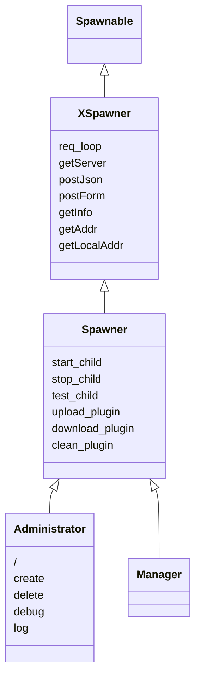
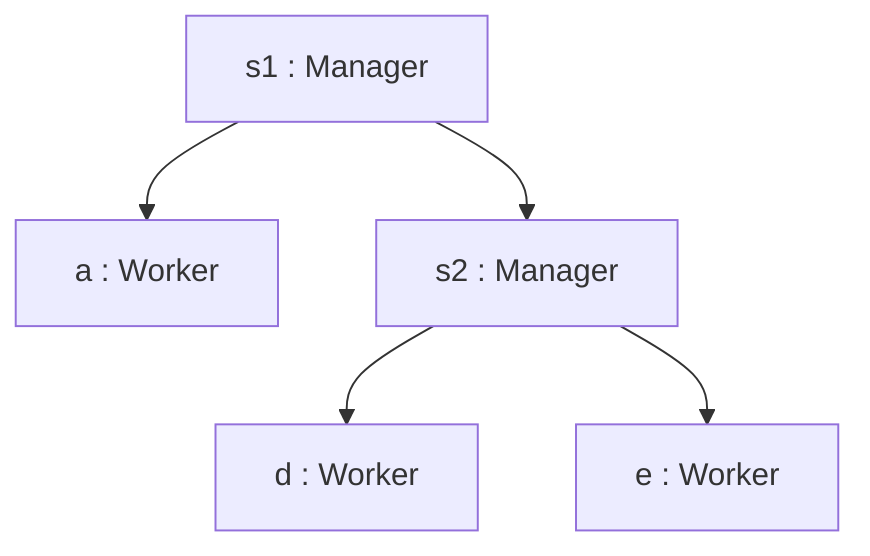

# 技术文档

## 类层次



- **Spawnable**: 应用或者服务的基础接口
- **XSpawner**: 实现了Spawnable的接口，系统启动入口类
- **Spawner**: 具有了服务管理功能，是所有插件的基类
- **Administrator**: 可视化管理插件

## 系统架构



- 一个系统是一棵树
- 一个系统可以嵌套若干子系统（子树）
- 每个节点都是Spawner的派生类实例
- 一个系统的非叶子节点（Mananger）一般是起到管理作用
- 一个系统的叶子节点（Worker）往往承载了具体的功能
- 系统有一个统一的域名和SSL认证测策略（如果有的话）
- 系统树同时也是依赖树，箭头反映了创建和依赖关系，下级节点由上级节点管理（创建、删除）

### 启停管理

#### 命令行

直接命令行启动形式

```bash
sudo /usr/bin/python3 -u -m xspawner --name xspawner --plugin administrator --host xspawner.com --port 8000 --access 0.0.0.0 --log --severity debug --ssl --certfile /etc/ssl/certs/xspawner.com.crt --keyfile /etc/ssl/private/xspawner.com.key
```

#### 服务管理

##### 命令
每一个节点都是一个Systemd服务实例，通过以下命令管理它们：./start, ./stop, ./drop, ./init, ./backup

启动服务集群并恢复上次停止时的状态、数据

```bash
./start
```
停止服务集群
```bash
./stop
```
停止服务集群并销毁服务状态及数据
```bash
./drop
```
创建配置文件的精灵
```bash
./init
```

备份数据库

```bash
./backup
```


##### 配置文件

config.json内容如下

```json
{
    "id": "xspawner",
    "plugin": "administrator",
    "host": "xspawner.com",
    "port": 8000,
    "access": "0.0.0.0",
    "parent": "",
    "log": true,
    "severity": "debug",
    "ssl": true,
    "certfile": "/etc/ssl/certs/xspawner.com.crt",
    "keyfile": "/etc/ssl/private/xspawner.com.key"
}
```

或可采用另一种配置文件格式: xspawner.ini

```ini
[DEFAULT]
id=xspawner
plugin=administrator
host=xspawner.com
port=8000
access=0.0.0.0
parent=

[log]
severity=debug

[ssl]
certifile=/etc/ssl/certs/xspawner.com.crt
keyfile=/etc/ssl/private/xspawner.com.key

```

配置参数 id 的解释：

> 服务实例的名称

配置参数 plugin 的解释：

> 服务的python包的名称

配置参数 host 的解释：

> 服务主机的对外名称（域名或IP地址）

配置参数 port 的解释：

> 服务的监听端口

配置参数 access 的解释：

> 服务的访问来源（0.0.0.0代表所有来源）

配置参数 parent 的解释：

> 服务的上级节点（服务的创建者）

配置参数 log severity 的解释：

> 服务运行是否打印日志，（如果打印日志）日志的打印门槛。

配置参数 ssl certfile keyfile 的解释：

> 参数 ssl 表明服务是否支持SSL安全认证。
>
> （如果支持）SSL（公钥和私钥）证书文件的路径通过参数certfile和keyfile指定。
>
> | ssl  | certfile | keyfile |                                                              |
> | ---- | -------- | ------- | ------------------------------------------------------------ |
> | 假   | 空       | 空      | 纯HTTP服务。适用于仅仅服务内部局域网，安全要求不高。         |
> | 真   | 真       | 真      | HTTPS服务，独立完成SSL认证。                                 |
> | 真   | 空       | 空      | HTTP服务，通过caddy自动申请SSL证书，实现动态反向代理，披露HTTPS访问地址。 |
>
> 自有证书一般存放在
>
> ```
> /etc/ssl/certs/
> /etc/ssl/private/
> ```
>
> Caddy支持自动向Let's Encript 申请免费证书，分发的免费证书的存储路径可能如下
>
> ```
> /var/lib/caddy/.local/share/caddy/certificates/acme-v02.api.letsencrypt.org-directory/xspawner.com/
> ```
>
> Caddy的典型配置（在真实域名 + 公网可达场景下）
>
> ```apl
> {
>     admin 127.0.0.1:2019
> }
> 
> xspawner.com {
>     # tls <certfile> <keyfile>
>     root * /usr/share/caddy
>     file_server
> }
> ```
>
> 屏蔽 tls 行, 即由 Caddy 全自动申请证书


### 容器部署

服务集群推荐采用容器化部署。

容器内具有 systemd + Caddy + xspawner 三个组件；容器只跑业务，管理走宿主机。

#### 容器配置文件

Dockerfile

```dockerfile
ARG UBUNTU_TAG=20.04
FROM ubuntu:${UBUNTU_TAG}

ENV DEBIAN_FRONTEND=noninteractive \
    PYTHONUNBUFFERED=1 \
    TZ=Asia/Shanghai

# ── 换源 ─────────────────────────────────────────────────────────────
RUN cp /etc/apt/sources.list /etc/apt/sources.list.bak \
    && sed -i 's/archive.ubuntu.com/mirrors.aliyun.com/g; s/security.ubuntu.com/mirrors.aliyun.com/g' /etc/apt/sources.list

# ── 基础软件（移除 openssh-server）────────────────────────────────────
RUN apt-get update && apt-get install -y --no-install-recommends \
    systemd \
    systemd-sysv \
    dbus \
    python3 \
    python3-pip \
    python3-dev \
    curl wget gnupg ca-certificates \
    net-tools iputils-ping vim tzdata \
    zip unzip jq openssl libssl-dev \
    sqlite3 \
    && ln -fs /usr/share/zoneinfo/Asia/Shanghai /etc/localtime \
    && dpkg-reconfigure --frontend noninteractive tzdata \
    && apt-get clean \
    && rm -rf /var/lib/apt/lists/* /tmp/* /var/tmp/* \
    && systemctl mask --now \
        systemd-logind.service \
        getty.target \
        systemd-udevd.service 2>/dev/null || true \
    && rm -f /lib/systemd/system/sysinit.target.wants/systemd-tmpfiles-setup.service \
    && rm -f /etc/systemd/system/getty.target.wants/getty@tty1.service \
    && mkdir -p /run/lock /run/systemd

# ── Caddy ─────────────────────────────────────────────────────────────
RUN curl -1sLf 'https://dl.cloudsmith.io/public/caddy/stable/gpg.key' \
        | gpg --dearmor -o /usr/share/keyrings/caddy-stable-archive-keyring.gpg \
    && curl -1sLf 'https://dl.cloudsmith.io/public/caddy/stable/debian.deb.txt' \
        | tee /etc/apt/sources.list.d/caddy-stable.list \
    && apt-get update && apt-get install -y --no-install-recommends caddy \
    && apt-get clean && rm -rf /var/lib/apt/lists/* \
    && mkdir -p /data /config

# ── Python 包 ─────────────────────────────────────────────────────────
RUN pip3 install --no-cache-dir --upgrade pip \
    && pip3 install --no-cache-dir \
        tornado==6.4.1 \
        pywebio==1.8.3 \
        requests==2.31.0 \
        ipaddress==1.0.23 \
        psutil==5.9.5 \
        bokeh==3.1.1 \
        tortoise-orm==0.23.0 \
        aiomysql==0.2.0 \
        asyncpg==0.30.0 \
        pyinstaller==6.22.3 \
    && python3 -c "import tornado, pywebio, requests, bokeh, tortoise; print('Python packages OK')"

# ── 运行时默认值 ───────────────────────────────────────────────────────
ENV HOST=xspawner.com \
    PORT=8000 \
    CERTFILE=/etc/ssl/certs/xspawner.com.crt \
    KEYFILE=/etc/ssl/private/xspawner.com.key \
    SEVERITY=info

# ── 目录与代码 ─────────────────────────────────────────────────────────
RUN mkdir -p /var/log/xspawner /opt/xspawner /etc/ssl/private /etc/caddy

WORKDIR /opt/xspawner

COPY ./xspawner ./xspawner
COPY ./Caddyfile /etc/caddy/Caddyfile
COPY ./entrypoint.sh /opt/xspawner/entrypoint.sh

RUN find /opt/xspawner -type f -name "*.py" -exec chmod 644 {} \; \
    && chmod +x /opt/xspawner/entrypoint.sh

# ── 端口与健康检查（去掉 22）───────────────────────────────────────────
EXPOSE 80 443

HEALTHCHECK --interval=30s --timeout=5s --start-period=90s --retries=3 \
    CMD curl -ksS https://127.0.0.1/ping | grep -q pong || exit 1

ENTRYPOINT ["/opt/xspawner/entrypoint.sh"]
CMD []
```

`systemd` 的设计前提是它自己**必须是 PID 1**才能正常工作。让 `entrypoint.sh` 最后 `exec /lib/systemd/systemd --system` 成为 PID 1。

用 heredoc 生成 `caddy.service` 与 `xspawner.service`，并用 `multi-user.target.wants/` 下的软链替代 `systemctl enable`。

`xspawner.service` 通过 `After=`/`Requires=` 保证 Caddy 先起、且 xspawner 去掉 `--ssl` 改为监听纯 HTTP 8000 由 Caddy 统一终结 TLS。

运行时用 `--privileged --cgroupns=host` 让 systemd 能挂载 cgroup、管理 unit——这样 xspawner 的 `systemctl start <child>` 就能成功拉起子服务，Caddy 再通过 `proxy.py` 动态注入的 `/service/ID/\*` 路由把请求代理到子服务端口，形成"systemd 管进程、Caddy 管流量、xspawner 管编排"的完整闭环。


#### 入口脚本

enerpoint.sh

```bash
#!/bin/bash
# -*- coding: utf-8 -*-
set -euo pipefail

HOST="${HOST:-xspawner.com}"
PORT="${PORT:-8000}"
ACCESS="${ACCESS:-0.0.0.0}"
CERTFILE="${CERTFILE:-/etc/ssl/certs/xspawner.com.crt}"
KEYFILE="${KEYFILE:-/etc/ssl/private/xspawner.com.key}"
SEVERITY="${SEVERITY:-info}"

# ── 1) 按需生成自签名证书 ──────────────────────────────────────────────
if [[ ! -s "${CERTFILE}" || ! -s "${KEYFILE}" ]]; then
    echo "[entrypoint] generating self-signed cert for ${HOST}"
    mkdir -p "$(dirname "${CERTFILE}")" "$(dirname "${KEYFILE}")"
    openssl req -x509 -nodes -days 365 -newkey rsa:2048 \
        -keyout "${KEYFILE}" -out "${CERTFILE}" \
        -subj "/C=CN/ST=Beijing/L=Beijing/O=xspawner/CN=${HOST}" \
        2>/dev/null
    chmod 644 "${CERTFILE}"
    chmod 640 "${KEYFILE}"
else
    echo "[entrypoint] reusing existing cert: ${CERTFILE}"
fi

# ── 2) caddy.service ──────────────────────────────────────────────────
cat >/etc/systemd/system/caddy.service <<'EOF'
[Unit]
Description=Caddy Web Server
After=network-online.target
Wants=network-online.target

[Service]
Type=simple
ExecStart=/usr/bin/caddy run --config /etc/caddy/Caddyfile --adapter caddyfile
ExecReload=/usr/bin/caddy reload --config /etc/caddy/Caddyfile --adapter caddyfile
Restart=on-failure
RestartSec=2
LimitNOFILE=1048576

[Install]
WantedBy=multi-user.target
EOF

# ── 3) xspawner.service（纯 HTTP，TLS 由 Caddy 终止）────────────────────
cat >/etc/systemd/system/xspawner.service <<EOF
[Unit]
Description=XSpawner Service
After=caddy.service network-online.target
Wants=caddy.service
Requires=caddy.service

[Service]
Type=simple
WorkingDirectory=/opt/xspawner
ExecStart=/usr/bin/python3 -u -m xspawner \\
    --id xspawner \\
    --plugin administrator \\
    --host ${HOST} \\
    --port ${PORT} \\
    --access ${ACCESS} \\
    --log --severity ${SEVERITY}
Restart=on-failure
RestartSec=3

[Install]
WantedBy=multi-user.target
EOF

# ── 4) enable：软链到 multi-user.target.wants ─────────────────────────
mkdir -p /etc/systemd/system/multi-user.target.wants
ln -sf /etc/systemd/system/caddy.service       /etc/systemd/system/multi-user.target.wants/caddy.service
ln -sf /etc/systemd/system/xspawner.service    /etc/systemd/system/multi-user.target.wants/xspawner.service

# ── 5) 交给 systemd（exec 替换本进程，systemd 成为 PID 1）──────────────
echo "[entrypoint] handing over to systemd (PID 1)"
exec /lib/systemd/systemd --system --unit=multi-user.target
```

#### 代理配置

/etc/caddy/Caddyfile

```apl
{
    admin 127.0.0.1:2019
    auto_https off
}

:443 {
    tls /etc/ssl/certs/xspawner.com.crt /etc/ssl/private/xspawner.com.key
    reverse_proxy 127.0.0.1:8000
}

:80 {
    redir https://{host}{uri} permanent
}
```

用 `:443` + 显式 `tls` + `auto_https off` + `reverse_proxy 127.0.0.1:8000` 兜底，形成「动态路由优先、xspawner 兜底、任意 Host 可访问、证书自签名可复现」的确定性结构，完全适配容器内 xspawner 的部署。


#### 容器启动

```bash
docker build -t xspawner:latest .

docker run -d --name xspawner \
    --privileged \
    --cgroupns=host \
    -p 80:80 -p 443:443 \
    -v xspawner-cert:/etc/ssl/certs \
    -v xspawner-key:/etc/ssl/private \
    -v xspawner-caddy:/data \
    -v xspawner-log:/var/log/xspawner \
    xspawner:latest
```

`/data` 是 Caddy 的持久化目录（虽然 `auto_https off` 后证书不落盘，但 Admin API 的自动保存、日志等可能用到，挂上更稳）。


#### 运维实操

##### 1. 从本地直接进容器（最常用）

```bash
# 本地 → 宿主机 → 容器，一步到位
ssh -t ops@<宿主机IP> "docker exec -it xspawner bash"

# 或者先进宿主机，再按需进容器
ssh ops@<宿主机IP>
docker exec -it xspawner bash
```

##### 2. Docker Context（CI 或长期运维）

```bash
# 配置（一次性）
docker context create xspawner-prod --docker "host=ssh://ops@<宿主机IP>"
docker context use xspawner-prod

# 之后所有命令都作用在远端
docker ps
docker exec -it xspawner bash
docker logs -f xspawner
docker cp xspawner:/opt/xspawner/xspawner.db ./local-backup.db
docker restart xspawner

# 切回本地
docker context use default
```


### 验证清单

```bash
# 1) PID 1 是 systemd
docker exec xspawner ps -p 1 -o comm=
# 期望：systemd

# 2) 两个业务 unit 都 active
docker exec xspawner systemctl is-active caddy.service xspawner.service
# 期望：active\nactive

# 3) 22 端口没有监听（确认 sshd 确实没启动）
docker exec xspawner ss -tlnp | grep :22 || echo "no sshd, as expected"
# 期望：no sshd, as expected

# 4) 对外端口正确
docker port xspawner
# 期望：只看到 80/tcp -> 0.0.0.0:80, 443/tcp -> 0.0.0.0:443

# 5) Caddy → xspawner 链路通
curl -k -i https://<宿主机IP>/ping
# 期望：200 OK, body = pong

# 6) 子服务能启动（走 xspawner UI 的 /create）
docker exec xspawner systemctl is-active <child_id>
# 期望：active
```


### 未来

- 容器化部署单域名服务集群
- 增加超级管理口令
- 完善鉴权权限管理
- 利用periodic方法检测下级心跳
- 整合SDD和模型代理Aider


### 其它
